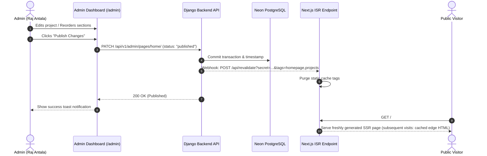

# Raj Antala Portfolio & Custom CMS — System Architecture

## 1. System Overview

The system is a decoupled, production-grade personal portfolio and content management system (CMS) engineered for **Raj Antala** (AI Engineer | Data Science | Generative AI). 

It consists of three core tiers:
1. **Frontend (Next.js App Router & React)**: 
   - **Public Portfolio**: Fast, SEO-optimized, responsive white-theme presentation layer.
   - **Custom Admin CMS**: Authenticated SaaS-style control center for dynamic website composition, full CRUD operations, media management, and analytics.
2. **Backend (Django & Django REST Framework)**:
   - Modular service-based architecture partitioned into distinct domain applications.
   - Role-guarded API layer segregating public read endpoints from protected admin management endpoints.
   - Dynamic website builder engine using structured section schema validation.
3. **Data & Storage Layer**:
   - **Neon PostgreSQL**: Primary relational store supporting ACID transactions, JSONB structures, and future vector embeddings via `pgvector`.
   - **Cloudinary**: Cloud-based asset management for profile pictures, project galleries, certificate proofs, and resume PDFs with automatic optimization.

---

## 2. High-Level Architecture Diagram

```mermaid
flowchart TB
    subgraph Clients["Client Layer (Browsers & Devices)"]
        PublicUser["Public Visitors (Desktop/Mobile)"]
        AdminUser["Super Admin (Raj Antala)"]
    end

    subgraph CDN["Edge & Delivery Layer"]
        VercelEdge["Vercel Edge Network / CDN"]
    end

    subgraph Frontend["Frontend Tier (Next.js App Router)"]
        PublicApp["(public) Portfolio Routes\n- Home, About, Projects\n- Skills, Experience, Education\n- Certifications, Contact, Resume"]
        AdminApp["/admin CMS Dashboard\n- Site Builder (Drag & Drop)\n- Content CRUD & Media Library\n- Analytics (Recharts) & SEO"]
        NextServer["Next.js Server / Middleware\n- Server-Side Rendering (SSR/ISR)\n- On-demand Cache Revalidation\n- Auth Session Proxy"]
    end

    subgraph Backend["Backend Tier (Django & DRF on Render)"]
        DRF["Django REST Framework API Gateway (/api/v1/)"]
        AuthMiddleware["Auth & Security Middleware\n- HttpOnly Session Cookies\n- CSRF Validation\n- Rate Limiting"]
        
        subgraph DjangoApps["Django Domain Applications"]
            AppAccounts["accounts"]
            AppProfile["profiles"]
            AppPages["pages (Builder)"]
            AppProjects["projects"]
            AppSkills["skills"]
            AppExp["experience"]
            AppEdu["education"]
            AppCerts["certifications"]
            AppTestimonials["testimonials"]
            AppNav["navigation & footer"]
            AppMedia["media_library"]
            AppContact["contact"]
            AppSEO["seo"]
            AppAnalytics["analytics"]
            AppSettings["site_settings"]
            AppAI["ai_assistant (Future RAG)"]
        end
    end

    subgraph DataStorage["Data & Cloud Storage"]
        NeonDB[("Neon PostgreSQL\n(Relational & JSONB Data\n+ Future pgvector)")]
        CloudinaryService[("Cloudinary\n(Images, Documents, Resumes)")]
    end

    PublicUser --> VercelEdge --> PublicApp
    AdminUser --> VercelEdge --> AdminApp
    PublicApp --> NextServer
    AdminApp --> NextServer
    NextServer --> DRF
    DRF --> AuthMiddleware
    AuthMiddleware --> DjangoApps
    DjangoApps --> NeonDB
    DjangoApps --> CloudinaryService
    AdminApp -. Upload Media .-> CloudinaryService
```



---

## 3. Technology Stack & Decision Matrix

| Layer | Technology | Version / Spec | Justification |
| :--- | :--- | :--- | :--- |
| **Frontend Framework** | Next.js (App Router) | 14+ / 15 | Hybrid rendering (Server Components for SEO + Client Components for interactive CMS builder), ISR for blazingly fast portfolio load times. |
| **Language** | TypeScript | 5.x | Strict type safety across API response contracts, CMS forms, and analytics visualization. |
| **Styling** | Tailwind CSS & Vanilla CSS tokens | 3.4+ / 4.x | Rapid utility-first development adhering strictly to the curated white-theme design tokens without runtime overhead. |
| **UI Components** | shadcn/ui & Radix UI primitives | Latest | Accessible, unstyled primitives customizable for bespoke white-theme minimalist styling. |
| **Icons** | Lucide React | Latest | Clean, consistent, lightweight SVG iconography. |
| **Charts** | Recharts | 2.x | Composable SVG-based chart library tailored for React dashboards and traffic analytics. |
| **Backend Framework**| Python & Django | Python 3.11+, Django 5.x | Robust ORM, built-in security, scalable architecture, and battle-tested stability. |
| **API Engine** | Django REST Framework | 3.15+ | Serializer validation, ViewSets, pagination, permissions, and filtering. |
| **Primary Database** | PostgreSQL via Neon | PG 16 | Serverless branching, relational integrity, JSONB support for builder sections, and `pgvector` ready for AI. |
| **Media Storage** | Cloudinary & `django-cloudinary-storage` | API v2 | Secure asset transformation, CDN delivery, file validation, and format conversion (WebP/AVIF). |
| **Deployment** | Vercel (Frontend) + Render (Backend) | Production tiers | Zero-config edge deployment for Next.js and robust containerized hosting for Django. |

---

## 4. Authentication, Security & Permission Architecture

1. **Super Admin Isolation**:
   - Single superuser account seeded via environment-controlled Django management commands.
   - Default Django administration (`/django-admin/`) is locked or rebound; all content administration flows through the custom `/admin` dashboard.
2. **Session Security & Token Handling**:
   - Secure HttpOnly, SameSite=Lax (or Strict in prod), Secure-flagged cookies for session identification.
   - CSRF protection enforced on all state-altering endpoints (`POST`, `PUT`, `PATCH`, `DELETE`).
   - No sensitive access tokens stored in browser `localStorage` or `sessionStorage`.
3. **CORS & Origin Policy**:
   - Explicit whitelist allowing only the authorized Next.js domain (e.g. `localhost:3000` in development and `portfolio.vercel.app` in production).
   - Strict credential exchange (`CORS_ALLOW_CREDENTIALS = True`).
4. **Rate Limiting & Threat Protection**:
   - Django REST Framework ScopedRateThrottle applied to `/api/v1/auth/login/` (e.g., 5 attempts per minute) and `/api/v1/public/contact/` (e.g., 3 submissions per hour per IP).
   - Input sanitization (XSS prevention) on all text inputs, preventing raw HTML/JS script injection into builder sections or descriptions.

---

## 5. Dynamic Content Publishing & Cache Revalidation Pipeline

To guarantee sub-second page performance for public visitors without sacrificing instant updates when the admin modifies content, an **On-Demand Cache Revalidation** pipeline is established:



- **Draft Previewing**: Admin can view unreleased drafts via protected preview URLs (`/preview?token=...`), which render content on-the-fly without purging public cache.
- **Content Lifecycle States**:
  - `draft`: Only visible inside CMS and preview mode.
  - `published`: Exposed via `/api/v1/public/*` and cached on the edge.
  - `archived`: Soft-deleted, hidden from public APIs, retainable for history.

---

## 6. Future AI Chatbot & RAG Integration Readiness

The system architecture anticipates Phase 9 AI Assistant integration through deliberate decoupling and data design:

1. **pgvector Integration**:
   - The PostgreSQL schema is structured so that published portfolio items (Projects, Skills, Experience, Education, Certifications, Bio) can easily populate a vectorized embedding table (`ai_embeddings`).
2. **Isolated AI Service Module**:
   - A dedicated Django app `apps/ai_assistant` will host background embedding sync signals:
     ```python
     # Concept: Signal triggers on model save when status == 'published'
     @receiver(post_save, sender=Project)
     def sync_project_embedding(sender, instance, **kwargs):
         if instance.status == 'published':
             ai_service.generate_and_store_embedding(instance)
     ```
3. **Strict Information Boundary**:
   - The query retriever will filter strictly `WHERE status = 'published' AND is_ai_accessible = True`, ensuring unreleased drafts, private contact notes, or admin credentials can never leak into prompt context.
4. **Provider-Agnostic LLM Connector**:
   - Configured to connect seamlessly to Google Gemini API (gemini-1.5-flash / gemini-2.5-pro) or OpenAI API with streaming SSE (Server-Sent Events) to the frontend widget.
