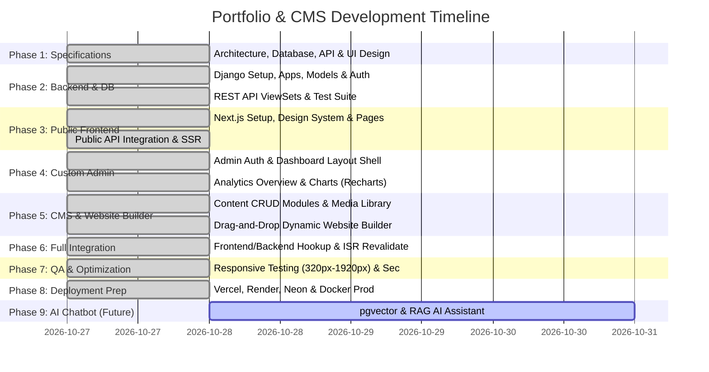

# Phased Development Roadmap & Execution Plan

This document establishes the structured roadmap for developing, testing, and deploying the **Raj Antala Portfolio & Custom CMS**. Each phase is bound by clear deliverables and quality verification gates.

---

## Roadmap Overview

---

## Detailed Phase Breakdown

### Phase 1: System Specifications & Design Architecture *(Completed)*
- [x] Full System Architecture document (`docs/architecture.md`)
- [x] Comprehensive Directory & File Structure layout (`docs/folder_structure.md`)
- [x] Relational Database ER Diagram & Django Models design (`docs/database_design.md`)
- [x] REST API Specification with Public & Admin contracts (`docs/api_specification.md`)
- [x] White-Theme UI Design System & Component Guidelines (`docs/ui_design_system.md`)
- [x] Phased Roadmap & Execution Gates (`docs/development_roadmap.md`)
- **Review Gate**: User review and sign-off on Phase 1 architectural documents before writing code.

---

### Phase 2: Django Backend & Database Engine
- **Objectives**:
  - Initialize modular Django structure with settings partitioning (`base`, `dev`, `prod`).
  - Configure PostgreSQL database connectivity with Neon support (fallback to SQLite for quick offline testing).
  - Scaffold 14 domain apps: `core`, `accounts`, `profiles`, `pages`, `projects`, `skills`, `experience`, `education`, `certifications`, `testimonials`, `navigation`, `media_library`, `contact`, `seo`, `analytics`, `site_settings`.
  - Execute migrations and verify relational integrity.
  - Implement serializers, permissions, and DRF ViewSets for both public and admin routes.
  - Create seed management command (`seed_portfolio_data`) with initial profile data for Raj Antala.
  - Run backend unit tests verifying model constraints and API response status codes.
- **Verification Gate**: All endpoints operational via Swagger/curl and unit tests pass.

---

### Phase 3: Public Portfolio Frontend
- **Objectives**:
  - Initialize Next.js App Router with TypeScript and Tailwind CSS.
  - Install and configure shadcn/ui components customized for the clean white theme (`#FFFFFF`, `#F8FAFC`, `#2563EB`).
  - Build public components: Header Navbar, HeroSection, AboutSection, SkillsGrid, ProjectCards, ExperienceTimeline, EducationCard, CertificationCard, ContactForm, and Footer.
  - Create dedicated public routes: `/`, `/about`, `/projects`, `/projects/[slug]`, `/skills`, `/experience`, `/education`, `/certifications`, `/resume`, `/contact`.
  - Connect public pages to Django API using server components with dynamic caching.
- **Verification Gate**: Responsive across 320px, 375px, 768px, 1024px, 1440px without layout shifts or horizontal scroll.

---

### Phase 4: Custom Admin Dashboard Shell & Analytics
- **Objectives**:
  - Implement secure admin login view (`/admin/login`) with credential validation and session cookie handling.
  - Build admin layout shell: Collapsible Sidebar, Header, User Profile Dropdown, Breadcrumbs, Notifications.
  - Implement Dashboard Overview (`/admin`) featuring Recharts analytics:
    - Visitor metrics over time (Area/Line chart).
    - Page views & project popularity (Bar chart).
    - Quick metric cards (Total visits, Projects, Skills, Unread inquiries).
    - Recent inquiries and quick-action links.
- **Verification Gate**: Unauthenticated users redirected; authenticated sessions load responsive dashboard shell.

---

### Phase 5: CMS CRUD Modules & Dynamic Website Builder
- **Objectives**:
  - Build CRUD interfaces for:
    - **Projects Manager**: Create, edit, tag with technologies, gallery upload, display order, publish toggle.
    - **Skills Manager**: Categorized skills, proficiency sliders, icon picker.
    - **Experience & Education**: Timeline managers with bullet-point responsibilities editor.
    - **Certifications & Testimonials**: Verifiable credential linkers and endorsement approvals.
    - **Profile & Resume Manager**: Update headline, bio, contact links, and resume PDF replacement.
    - **Navigation & Footer Manager**: Dynamic menu orderer and link manager.
    - **SEO Manager**: Edit meta tags, OpenGraph previews, and robots directives.
    - **Contact Inbox**: Mark as read, archive, and delete messages.
    - **Media Library**: Upload, search, preview, and delete Cloudinary assets.
  - **Dynamic Website Builder**:
    - Interactive section manager for the homepage.
    - Reorder sections via drag-and-drop or rank adjustments.
    - Toggle visibility (show/hide section on live site).
    - Real-time configuration editor for section titles and layouts.
    - Live draft preview mode before publishing.
- **Verification Gate**: Admin changes reflect dynamically without source code modification.

---

### Phase 6: Full Integration & Cache Revalidation
- **Objectives**:
  - Wire Next.js on-demand ISR revalidation webhook (`/api/revalidate`) triggered upon CMS publish events.
  - Test end-to-end publishing workflow: Edit in CMS -> Publish -> Immediate live reflection.
  - Wire contact form submission from public site to Django database with notification triggers.
  - Implement silent analytics tracker for public page visits.
- **Verification Gate**: End-to-end data flow verified between browser, Next.js server, Django, and PostgreSQL.

---

### Phase 7: Testing, Optimization & Security Audit
- **Objectives**:
  - Comprehensive responsive viewport audit: 320px, 375px, 425px, 640px, 768px, 1024px, 1280px, 1440px, 1920px.
  - Cross-browser compatibility check (Chrome, Safari, Firefox, Edge).
  - Security hardening: CSRF headers, rate limiting on auth and contact endpoints, XSS sanitization on rich inputs.
  - Performance optimization: Image optimization via Cloudinary, lazy loading, font optimization with `next/font`.
  - Lighthouse audit targeting 95+ in Performance, Accessibility, Best Practices, and SEO.
- **Verification Gate**: Zero horizontal scrolling, zero console errors, clean security audit.

---

### Phase 8: Production Deployment Preparation
- **Objectives**:
  - Create production configurations:
    - Frontend deployment configuration for **Vercel**.
    - Backend deployment scripts, Procfile, and `render.yaml` for **Render**.
    - Managed PostgreSQL configuration for **Neon**.
    - Media storage configuration for **Cloudinary**.
  - Provide master `.env.example` with documented environment variables.
  - Write complete production operations runbook and README.
- **Verification Gate**: Application builds successfully with `npm run build` and `python manage.py check --deploy`.

---

### Phase 9: Future AI Chatbot Integration (Next Cycle)
- **Objectives**:
  - Activate `pgvector` extension on Neon PostgreSQL database.
  - Implement embedding generation pipeline on published portfolio items.
  - Build RAG (Retrieval-Augmented Generation) chat endpoint connected to Gemini API / OpenAI API.
  - Embed floating interactive AI Assistant widget on the public portfolio.
